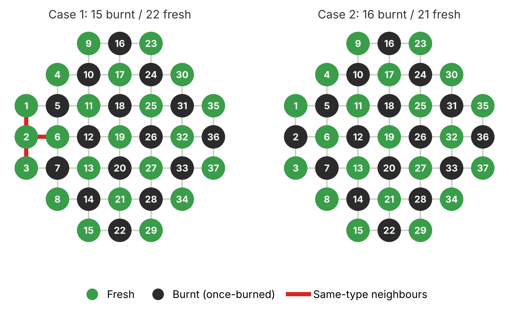

# QUBO Optimization for In-Core Fuel Management

Loading a 37-cell nuclear reactor core with fresh and burnt (once-burned) fuel so that as few neighbouring cells as possible hold the same fuel type. The problem is formulated as a QUBO and solved with simulated annealing (OpenJij). An exact solver then confirms that the layouts found are optimal.

*Amr Mohamed. NSF Research Experience for Teachers (RET), University of Houston, Summer 2025. Mentor: Dr. Lei Fan. Program Director: Dr. Weihang Zhu.*

## Results

| Case | Burnt | Fresh | Best energy (simulated annealing) | Proven minimum (exact solver) |
|:---:|:---:|:---:|:---:|:---:|
| 1 | 15 | 22 | 3.00 | 3 |
| 2 | 16 | 21 | 0.00 | 0 |

Simulated annealing reached the proven optimum in both cases. Case 2 has a perfect checkerboard layout; Case 1 cannot, and its best layout has 3 same-type pairs.



## Files

| File | What it does |
|---|---|
| `In_core.ipynb` | Main code: builds the model in JijModeling, converts it to a QUBO, solves it with OpenJij simulated annealing, and plots the layout |
| `exact_check.py` | Solves the same problem exactly (mixed-integer program, HiGHS via SciPy) to prove the optimal number of same-type pairs |
| `QUBO_InCore_Fuel_Management_Report.pdf` | Full report: model, QUBO formulation, results, verification and next steps (`.docx` version also included) |
| `figures/` | Core numbering map and result layouts |

## Model in brief

- 37 cells on a square lattice, 60 neighbouring pairs, 74 binary variables x<sub>k,i</sub> (cell i holds fuel type k).
- **Objective:** minimize the number of neighbouring pairs holding the same fuel type.
- **Constraints:** one assembly per cell, and the counts of fresh and burnt assemblies match the inventory.
- Constraints become squared penalties (weight λ = 5) to form the QUBO. Every term is nonnegative, so any energy below 5 means all constraints are satisfied.

## How to run

```bash
pip install -r requirements.txt
jupyter notebook In_core.ipynb   # simulated annealing with OpenJij
python exact_check.py            # exact optimum for both cases
```

## Next steps

Three fuel types (fresh, once-burned and twice-burned), a full 193-assembly reactor core, and a runtime and solution-quality comparison between simulated annealing and an exact solver.

## References

1. Galperin, A. (1995). *Nuclear Science and Engineering*, 119, 144–152.
2. Usmanov, S. R., Salakhov, G. V., Bozhedarov, A. A., Kiktenko, E. O., & Fedorov, A. K. (2023). *Quantum and quantum-inspired optimization for an in-core fuel management problem.* arXiv:2308.13348.
3. Jij Inc. JijModeling. https://www.jijzept.com
4. Jij Inc. OpenJij (v0.10.7). https://www.openjij.org
